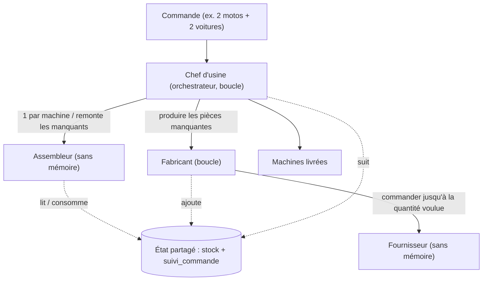

# MCP-Orchestration — Usine d'agents

**Tutoriel d'orchestration multi-agents + MCP sur un fil rouge concret : une usine qui fabrique des machines à la commande.**


On y voit, sur un seul exemple, les cas de figure de l'orchestration : orchestrateur, sous-agents,
boucles, réutilisation d'agents, profondeur (un agent qui appelle un agent), état partagé, et outils
exposés via MCP (FastMCP).

## Documentation

À lire d'abord : [`docs/architecture.md`](docs/architecture.md) — la spécification complète (avec le schéma).

| Document | Contenu |
|---|---|
| [docs/CADRAGE.md](docs/CADRAGE.md) | Le pourquoi : objectifs, périmètre, hypothèses, décisions |
| [docs/architecture.md](docs/architecture.md) | Le comment : agents, MCP, outils, flux, règles |
| [docs/adapter-a-votre-projet.md](docs/adapter-a-votre-projet.md) | Réutiliser ce squelette sur un autre sujet |

## Architecture

Une commande (ex. `2 motos + 2 voitures`) est traitée par le **Chef d'usine** (orchestrateur), qui
délègue à trois sous-agents. Chaque agent a son propre MCP (sa boîte à outils) ; l'état partagé (stock
+ suivi) est la mémoire commune.



Détails et règles complètes : [`docs/architecture.md`](docs/architecture.md).

## Ce que ça fait

On passe une commande (ex. `2 motos + 2 voitures`). Le Chef d'usine (orchestrateur) :

1. demande à l'Assembleur d'assembler chaque machine ;
2. si des pièces manquent, demande au Fabricant de les produire ;
3. le Fabricant commande au Fournisseur (qui livre 1 à 5 pièces au hasard), et recommande jusqu'à
   obtenir la quantité voulue, puis met le stock à jour ;
4. le Chef relance l'Assembleur, qui assemble et livre.

Chaque action (quel agent, quel outil, quels arguments, quel résultat, à quelle profondeur) est
journalisée et affichée dans une interface Streamlit pour se balader dans l'arbre d'agents.

## Parcours d'apprentissage (ordre conseillé)

1. **Survol** — ce README, puis [`docs/architecture.md`](docs/architecture.md) et son schéma.
2. **Voir tourner** — `uv run python -m usine.main "2 motos + 2 voitures"` : lire le journal
   indenté par profondeur (qui appelle qui).
3. **Le moteur** — [`usine/agent.py`](usine/agent.py) (la boucle ReAct) et
   [`usine/trace.py`](usine/trace.py). Générique, valable pour tout projet.
4. **La logique métier** — [`usine/cerveau.py`](usine/cerveau.py), classe `CerveauFake` :
   une politique déterministe par agent. C'est le cœur pédagogique.
5. **Les outils et l'état** — [`usine/mcp_servers.py`](usine/mcp_servers.py) et
   [`usine/etat.py`](usine/etat.py).
6. **Le câblage** — [`usine/orchestration.py`](usine/orchestration.py) : comment l'arbre d'agents
   est assemblé.
7. **Les tests comme doc** — [`tests/test_cerveau_fake.py`](tests/test_cerveau_fake.py) décrit, pas
   à pas, le comportement de chaque agent.
8. **Adapter à votre projet** — [`docs/adapter-a-votre-projet.md`](docs/adapter-a-votre-projet.md).

Chaque module Python porte en tête un repère : `MOTEUR GÉNÉRIQUE` (réutilisable tel quel) vs
`EXEMPLE MÉTIER` (à réécrire pour votre domaine).

## Démarrage

**Prérequis** : [uv](https://docs.astral.sh/uv/).

```bash
uv sync                       # crée l'env et installe les dépendances

# 1) Démo en ligne de commande, SANS LLM (cerveau déterministe) :
uv run python -m usine.main "2 motos + 2 voitures"

# 2) Interface de suivi :
uv run streamlit run usine/streamlit_app.py
```

Par défaut, `LLM_PROVIDER=fake` : tout tourne sans modèle, de façon déterministe — pratique pour
explorer l'architecture. Pour brancher Gemma E4B via Ollama :

```bash
cp .env.example .env          # puis mettre LLM_PROVIDER=ollama
ollama pull gemma3n:e4b       # récupérer le modèle
uv run python -m usine.main "2 motos + 2 voitures"
```

## Configuration

Variables lues depuis `.env` (voir [`.env.example`](.env.example) et [`usine/config.py`](usine/config.py)) :

| Variable | Défaut | Effet |
|---|---|---|
| `LLM_PROVIDER` | `fake` | Cerveau des agents : `fake` (déterministe, sans LLM) ou `ollama` (Gemma E4B). |
| `OLLAMA_URL` | `http://localhost:11434` | URL du serveur Ollama (utilisée seulement si `LLM_PROVIDER=ollama`). |
| `OLLAMA_MODEL` | `gemma3n:e4b` | Modèle Ollama à interroger. |
| `STOCK_INITIAL` | `roue:3,batterie:2,chassis:1` | Stock de départ de l'usine (format `pièce:quantité` séparés par des virgules). |
| `SEED` | *(vide)* | Graine du Fournisseur. Vide = vrai aléatoire ; un entier = exécution reproductible. |

## Tests

```bash
uv sync --group dev   # installe pytest
uv run pytest
```

La suite couvre l'analyse de commande, l'état partagé, la trace, la politique de chaque agent
(`CerveauFake`), le `CerveauOllama` (sans serveur, appel réseau simulé) et un scénario complet
de bout en bout, reproductible grâce à `SEED`. Les tests valent aussi comme documentation
exécutable du comportement attendu.

> Note : si le venv est sur un montage réseau Windows (`\\?\UNC\...`, ex. projet WSL ouvert
> depuis Windows), pytest saute le test de bout en bout car le chargement de la DLL pywin32 y
> échoue ; il s'exécute normalement ailleurs (CI Linux). Préfixez vos commandes uv par
> `UV_LINK_MODE=copy` dans ce cas.

## Lancer avec Docker

```bash
docker compose up --build
```

- `ollama` : sert le modèle local, exposé sur le port `11434`.
- `app` : l'interface Streamlit, exposée sur http://localhost:8501

| Service | URL / Port | Note |
|---|---|---|
| app (Streamlit) | http://localhost:8501 | Interface de suivi |
| ollama | localhost:11434 | Serveur LLM local |

La première fois, télécharger le modèle dans le conteneur Ollama :

```bash
docker compose exec ollama ollama pull gemma3n:e4b
```

## Modes du « cerveau »

| `LLM_PROVIDER` | Effet |
|---|---|
| `fake` (défaut) | Cerveau déterministe qui applique les règles. Aucune dépendance, reproductible — pratique pour comprendre et tester l'arbre d'agents. |
| `ollama` | Les agents décident via Gemma E4B (Ollama). |

Les outils sont des stubs (ils renvoient un jeton), sauf `fournir_pieces` qui tire un nombre
aléatoire entre 1 et 5 — c'est ce qui crée la boucle du Fabricant.

## Structure du projet

```text
MCP-Orchestration/
├── README.md
├── docs/
│   ├── CADRAGE.md                 # le pourquoi : objectifs, périmètre, hypothèses, décisions
│   ├── architecture.md            # LA spec (agents, MCP, outils, flux, règles)
│   ├── adapter-a-votre-projet.md  # guide : réutiliser ce squelette ailleurs
│   └── schema_architecture.svg
├── usine/                     # le package Python
│   ├── config.py              # recettes + configuration LLM
│   ├── etat.py                # état partagé : stock + suivi_commande
│   ├── trace.py               # journal d'événements (pour Streamlit)
│   ├── cerveau.py             # le « cerveau » : mode fake (déterministe) ou ollama (Gemma)
│   ├── agent.py               # classe Agent + boucle ReAct générique
│   ├── mcp_servers.py         # les MCP (FastMCP) : atelier, fabrication, fournisseur
│   ├── orchestration.py       # assemble les agents et lance une commande
│   ├── main.py                # lancement en ligne de commande
│   └── streamlit_app.py       # interface de suivi
├── tests/                     # suite pytest (un fichier par module)
├── pyproject.toml             # dépendances (uv)
├── Dockerfile
├── docker-compose.yml         # Ollama + l'app Streamlit
├── .env.example               # variables de configuration
├── .github/workflows/         # CI (pytest)
└── LICENSE                    # MIT
```

## Licences & composants

| Composant | Rôle | Licence |
|---|---|---|
| FastMCP | Serveurs & client MCP | Apache-2.0 |
| Streamlit | Interface de suivi | Apache-2.0 |
| httpx | Appels HTTP vers Ollama | BSD-3-Clause |
| python-dotenv | Lecture du `.env` | BSD-3-Clause |
| Ollama (mode `ollama`) | Serveur LLM local (Gemma) | MIT — licence du modèle à confirmer |
| Ruff / pytest | Lint / tests | MIT |
| **Ce projet** | Code applicatif | MIT (voir [LICENSE](LICENSE)) — Copyright (c) 2026 floSa |
