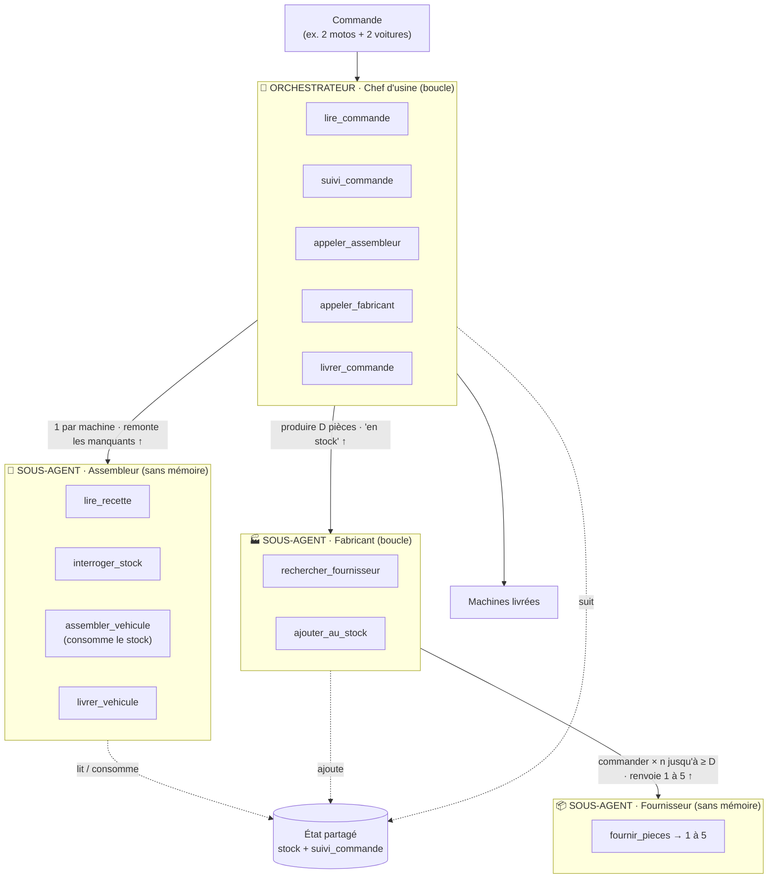

# Architecture — Usine d'agents (MCP-Orchestration)

> Tutoriel d'orchestration **multi-agents + MCP**, sur un fil rouge concret :
> **une usine qui fabrique des machines à la commande**.
> Le but pédagogique : *se balader* dans un arbre d'agents (orchestrateur → sous-agents),
> voir des **boucles**, de la **réutilisation** d'agents, de la **profondeur**, un **état partagé**,
> et des **outils** exposés via **MCP** (FastMCP).

---

## 1. Vocabulaire (à lire en premier)

| Terme | Définition courte |
|---|---|
| **Agent** | Un **LLM** + une **boucle** + une **boîte à outils** (son/ses MCP). C'est l'agent qui *boucle* ; il se *sert* du LLM pour décider l'action suivante. Un agent fait **plusieurs choses** car il a **plusieurs outils**. |
| **MCP** | Un *serveur d'outils* (protocole Model Context Protocol). Ici, un MCP par agent, construit avec **FastMCP**. |
| **Outil** | Une fonction exposée par un MCP. Peut être **déterministe** (code pur) ou **à base de LLM**. |
| **Délégation** | Un agent qui en appelle un autre (`appeler_assembleur`, …). C'est la **seule** source de profondeur. |
| **État partagé** | La mémoire commune du système : le **stock** + le **suivi de commande**. |

Règle d'or : **on ne met un agent (donc un LLM) que là où il y a une vraie décision ou itération.**
Tout le reste reste du code déterministe — c'est moins cher et plus fiable (essentiel avec un petit modèle local).

---

## 2. Schéma d'ensemble

Points clés du schéma :

- **Chef d'usine** = orchestrateur. Il route, **boucle sur les machines** et garde l'avancement dans `suivi_commande`.
- **Assembleur** et **Fabricant** sont **deux sous-agents frères** : ils **ne se parlent jamais directement**, c'est le Chef qui relaie.
- **Fabricant → Fournisseur** : c'est là qu'est la **profondeur** (un sous-agent qui en appelle un autre).
- L'**état partagé** (`stock` + `suivi`) est la mémoire commune.

---

## 3. Les données

### Recettes (nomenclatures)

| Machine | roues | batteries | châssis |
|---|---|---|---|
| Moto | 2 | 1 | 1 |
| Voiture | 4 | 3 | 2 |
| Camion | 4 | 8 | 4 |

### État partagé

- `stock` : `{roue: n, batterie: n, chassis: n}` — **+** alimenté par le Fabricant, **−** consommé par l'Assembleur.
- `suivi_commande` : pour chaque machine, son état (`à_faire` → `manque_pieces` → `réappro_ok` → `livrée`).

---

## 4. Le déroulé (règles)

Pour **chaque machine** de la commande :

1. **Chef** : `lire_commande`, met à jour `suivi_commande`, puis `appeler_assembleur(machine)`.
2. **Assembleur** : `lire_recette` → `interroger_stock` → calcule le **déficit** `D = besoin − stock` :
   - **D nul** → `assembler_vehicule` (**consomme** le stock) + `livrer_vehicule` → remonte « livré ».
   - **D > 0** → remonte au Chef la liste `{pièce: D}` (il n'appelle **pas** le Fabricant).
3. **Chef** → `appeler_fabricant({pièce: D})`.
4. **Fabricant** (pour chaque pièce manquante) :
   - `rechercher_fournisseur(pièce)`,
   - puis **boucle** : délègue au **Fournisseur** qui `fournir_pieces` (renvoie **1 à 5**),
   - **cumule** ce qu'il reçoit jusqu'à `≥ D` (sa *mémoire de boucle*),
   - `ajouter_au_stock(pièce, total)`,
   - remonte « en stock ».
5. **Chef** → **rappelle l'Assembleur** (retour étape 2) → cette fois il assemble et livre.
6. Quand **toutes** les machines sont livrées → `livrer_commande`.

### Cohérences importantes

- Le **déficit** est calculé par l'Assembleur (il a la recette ET le stock).
- `assembler_vehicule` **consomme** réellement le stock → la machine suivante voit le bon stock.
- Le **surplus** produit par le Fabricant **reste en stock** → réutilisé par la machine suivante.
- **Mémoire** : seul le **Chef** a un état persistant (`suivi_commande`) ; le **Fabricant** n'a qu'une *mémoire de boucle* (le cumulé) ; **Assembleur** et **Fournisseur** sont **sans mémoire**.

---

## 5. Qui possède quoi (récapitulatif)

| Agent | Boucle ? | Mémoire | Son MCP (outils) |
|---|---|---|---|
| **Chef d'usine** (orchestrateur) | oui | `suivi_commande` (persistant) | `lire_commande`, `suivi_commande`, `livrer_commande` + délégations `appeler_assembleur`, `appeler_fabricant` |
| **Assembleur** | non | aucune | `lire_recette`, `interroger_stock`, `assembler_vehicule`, `livrer_vehicule` |
| **Fabricant** | oui | mémoire de boucle (cumulé) | `rechercher_fournisseur`, `ajouter_au_stock` + délégation `appeler_fournisseur` |
| **Fournisseur** | non | aucune | `fournir_pieces` (→ aléatoire 1 à 5) |

---

## 6. Technique

- **LLM** : modèle **local Gemma E4B** via **Ollama** (ou vLLM). Un mode `fake` (cerveau déterministe) permet de
  tout faire tourner **sans LLM**, pour tester l'arbre d'agents.
- **MCP** : **FastMCP** — un serveur par agent, appelé via un **client en mémoire** (pas de sous-process).
- **Outils** : des **stubs** (renvoient un jeton), sauf `fournir_pieces` qui tire un **aléatoire 1–5**.
- **Suivi** : chaque action (agent, outil, args, résultat, profondeur) est journalisée → affichée dans **Streamlit**.
- **Docker** : `ollama` + l'app **Streamlit** via `docker compose`.

Voir [`schema_architecture.svg`](schema_architecture.svg) pour la version dessinée, et le
[README](../README.md) pour le lancement.
