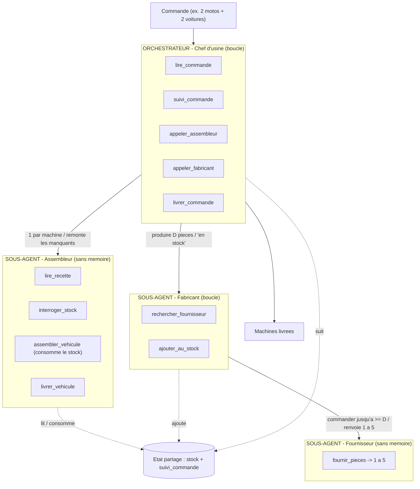

# Architecture — Usine d'agents (MCP-Orchestration)

Tutoriel d'orchestration multi-agents + MCP, sur un fil rouge concret : une usine qui fabrique
des machines a la commande. Objectif pedagogique : se balader dans un arbre d'agents
(orchestrateur -> sous-agents), voir des boucles, de la reutilisation d'agents, de la profondeur,
un etat partage, et des outils exposes via MCP (FastMCP).

---

## 1. Vocabulaire (a lire en premier)

| Terme | Definition courte |
|---|---|
| Agent | Un LLM + une boucle + une boite a outils (son/ses MCP). C'est l'agent qui boucle ; il se sert du LLM pour decider l'action suivante. Un agent fait plusieurs choses car il a plusieurs outils. |
| MCP | Un serveur d'outils (protocole Model Context Protocol). Ici, un MCP par agent, construit avec FastMCP. |
| Outil | Une fonction exposee par un MCP. Peut etre deterministe (code pur) ou a base de LLM. |
| Delegation | Un agent qui en appelle un autre (appeler_assembleur, ...). C'est la seule source de profondeur. |
| Etat partage | La memoire commune du systeme : le stock + le suivi de commande. |

Regle d'or : on ne met un agent (donc un LLM) que la ou il y a une vraie decision ou iteration.
Tout le reste reste du code deterministe — c'est moins cher et plus fiable (essentiel avec un
petit modele local).

---

## 2. Schema d'ensemble



Points cles :

- Chef d'usine = orchestrateur. Il route, boucle sur les machines et garde l'avancement dans
  suivi_commande.
- Assembleur et Fabricant sont deux sous-agents freres : ils ne se parlent jamais directement,
  c'est le Chef qui relaie.
- Fabricant -> Fournisseur : c'est la qu'est la profondeur (un sous-agent qui en appelle un autre).
- L'etat partage (stock + suivi) est la memoire commune.

---

## 3. Les donnees

### Recettes (nomenclatures)

| Machine | roues | batteries | chassis |
|---|---|---|---|
| Moto | 2 | 1 | 1 |
| Voiture | 4 | 3 | 2 |
| Camion | 4 | 8 | 4 |

### Etat partage

- stock : `{roue: n, batterie: n, chassis: n}` — alimente par le Fabricant, consomme par
  l'Assembleur.
- suivi_commande : `{machine_id: statut}`, avec un cycle de vie simple en trois etats :

  ```
  à faire  ->  en cours  ->  fini
  ```

  `lire_commande` initialise chaque machine a `à faire` ; le Chef la passe `en cours` quand il
  commence a s'en occuper, puis `fini` une fois livree. Le suivi donne donc l'avancement « gros
  grain » (visible d'un coup d'oeil dans Streamlit), tandis que le detail — manque de pieces,
  reapprovisionnement — reste lisible dans la trace.

---

## 4. Le deroule (regles)

Pour chaque machine de la commande :

1. Chef : lire_commande pour obtenir le plan, prend la premiere machine pas encore `fini`,
   la passe `en cours`, puis appeler_assembleur(machine).
2. Assembleur : lire_recette -> interroger_stock -> calcule le deficit `D = besoin - stock` :
   - D nul -> assembler_vehicule (consomme le stock) + livrer_vehicule -> remonte "livre".
   - D > 0 -> remonte au Chef la liste `{piece: D}` (il n'appelle pas le Fabricant).
3. Chef -> appeler_fabricant(`{piece: D}`).
4. Fabricant (pour chaque piece manquante) :
   - rechercher_fournisseur(piece),
   - puis boucle : delegue au Fournisseur qui fournir_pieces (renvoie 1 a 5),
   - cumule ce qu'il recoit jusqu'a `>= D` (sa memoire de boucle),
   - ajouter_au_stock(piece, total),
   - remonte "en stock".
5. Chef -> rappelle l'Assembleur (retour etape 2) -> cette fois il assemble et livre.
6. Des qu'une machine est livree, le Chef la marque `fini` dans suivi_commande, puis passe a la
   suivante. Quand toutes les machines sont `fini` -> livrer_commande.

### Coherences importantes

- Le deficit est calcule par l'Assembleur (il a la recette ET le stock).
- assembler_vehicule consomme reellement le stock -> la machine suivante voit le bon stock.
- Le surplus produit par le Fabricant reste en stock -> reutilise par la machine suivante.
- Memoire : seul le Chef a un etat persistant (suivi_commande) ; le Fabricant n'a qu'une memoire
  de boucle (le cumule) ; Assembleur et Fournisseur sont sans memoire.

---

## 5. Qui possede quoi (recapitulatif)

| Agent | Boucle ? | Memoire | Son MCP (outils) |
|---|---|---|---|
| Chef d'usine (orchestrateur) | oui | suivi_commande (persistant) | lire_commande, suivi_commande, livrer_commande + delegations appeler_assembleur, appeler_fabricant |
| Assembleur | non | aucune | lire_recette, interroger_stock, assembler_vehicule, livrer_vehicule |
| Fabricant | oui | memoire de boucle (cumule) | rechercher_fournisseur, ajouter_au_stock + delegation appeler_fournisseur |
| Fournisseur | non | aucune | fournir_pieces (1 a 5) |

---

## 6. Technique

- LLM : modele local Gemma E4B via Ollama (ou vLLM). Un mode `fake` (cerveau deterministe) permet
  de tout faire tourner sans LLM, pour tester l'arbre d'agents.
- MCP : FastMCP — un serveur par agent, appele via un client en memoire (pas de sous-process).
- Outils : des stubs (renvoient un jeton), sauf fournir_pieces qui tire un aleatoire 1 a 5.
- Suivi : chaque action (agent, outil, args, resultat, profondeur) est journalisee -> affichee
  dans Streamlit.
- Docker : ollama + l'app Streamlit via docker compose.
- Garde-fou : chaque agent est borne a `MAX_ITERATIONS` (`usine/agent.py`) pour eviter toute
  boucle infinie. Avec la graine `SEED`, tout le mode `fake` est reproductible (c'est ce qui
  permet de l'asserter dans les tests).

Voir [`schema_architecture.svg`](schema_architecture.svg) pour la version dessinee, et le
[README](../README.md) pour le lancement.
